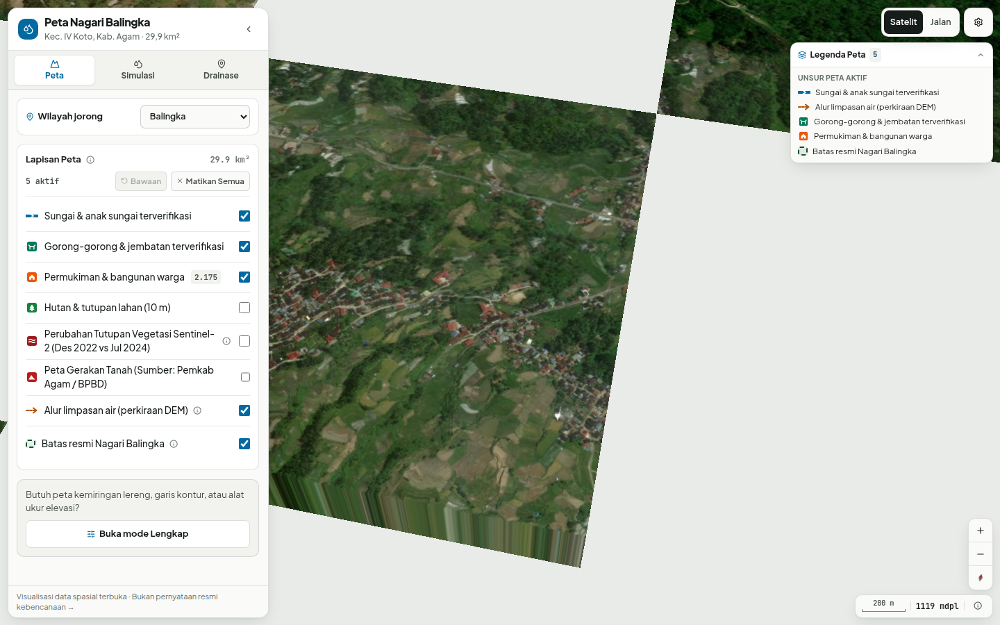

# Nagari Balingka Community GIS

[](./LICENSE)
[](https://nodejs.org/)

Open-source (**MIT**) public spatial data viewer, terrain & drainage inventory, computational terrain-flow visualizer, and collaborative waterway & boundary editor — built for **Nagari Balingka** (`29.89 km²`, `1,032–2,869 mdpl`, Kec. IV Koto, Kab. Agam, West Sumatra) and configurable for **any Indonesian Desa / Nagari** via [`region.config.json`](./region.config.json).



> **Scope & Role Boundary:** This application displays open geospatial datasets (BIG, Pemkab Agam, ESA/Copernicus, OpenStreetMap) and field-recorded infrastructure data alongside computational terrain visualizations — it **does not** issue disaster predictions, hazard declarations, or official evacuation designations. Official hazard assessments and emergency directives belong exclusively to **BNPB**, **BPBD Kab. Agam**, **BMKG**, **PVMBG**, and **Wali Nagari Balingka**.

Clipped strictly to the official **Badan Informasi Geospasial (BIG) June 2026** Nagari Balingka perimeter (`KDEPUM 13.06.05.2003`) while computing hydrology on a padded catchment box behind the scenes, the app combines **BIG DEMNAS (`542×760`, ~13.8 m)** terrain rasters (*Elevasi*, *Relief*, *Lereng*), official **Pemkab Agam & BIG RBI 50K** reference layers, **ESA WorldCover 10m** forest cover, **Copernicus Sentinel-2 L2A** NDVI vegetation-cover difference, **Google Open Buildings v3 + OSM** settlement footprints (`2,175` buildings), and an immutable **SQLite Audit Trail** in a clean `Ringkas` / `Lengkap` interface.

---

## Key Capabilities

1. **Two-Tier Interface (`Ringkas` & `Lengkap`) + Floating Active Map Legend**
   - **Ringkas (default)**: Plain-language public mode with 3 tabs (**Peta**, **Simulasi**, **Drainase**), Jorong quick-jump dropdown (*Balingka*, *Subarang*, *Koto Hilalang*, *Pahambatan*), layer quick actions (*Bawaan* / *Matikan Semua*), unified **Lapisan Peta** with matching cartographic badge icons (`LegendIcon`), desktop collapsible **Legenda Peta** (`ActiveMapLegend`), and mobile **Legenda** popover.
   - **Lengkap**: Adds 2D/3D toggle, 6 surface modes (**Satelit**, **Elevasi**, **Relief**, **Lereng**, **Topo**, **Jalan**), 3D relief height scaling, **BIG RBI 50K** rivers, **KLHK SK 35** protected forest, **Andosol/Kambisol** soil & geology overlays, **Drop Raindrop (*Cek Arah Air*)**, **Elevation Profile (*Ukur Tanjakan*)**, tap-to-inspect **Pemkab Agam Open Map Attributes**, and the **Editor** tab.
   - **Clean HUD & Unified Map Controls**: Top-right **Pengaturan** gear popover consolidates view mode (`Ringkas`/`Lengkap`), language (`ID`/`EN`), **Masukan**, and **Info & Data**; bottom-right stacks `+ / − / Compass` above an inline metric scale, live elevation/slope telemetry (`mdpl`), and `(i)` attribution popover.
   - **Info & Data Drawer**: Bilingual (`ID` / `EN`) 4-tab modal covering a public guide + explicit role boundaries (**Tentang & Panduan**), terrain/hydrology methodology (**Data & Metodologi**), a searchable bilingual **Glosarium** (`18` GIS, hydrology, and local terms with reference links), and **Sumber Terbuka** (GitHub repository link, MIT stack & data provenance).

2. **Computational Terrain Flow Model Visualizer (`Simulasi`)**
   - Driven by interactive **Curah hujan / Intensitas curah hujan** (`10–150 mm/jam`) × **Lama hujan / Durasi hujan** (`15 mnt – 6 jam`) sliders, quick scenarios (*Hujan Biasa*, *Hujan Hulu Gunung*, *Hujan Sangat Ekstrem*, *Atur manual*), timeline playback, toggleable **Lapisan Sungai di Simulasi** (verified waterways & BIG RBI 50K rivers), and intensity-scaled visual rainfall overlay (`RainOverlay`).
   - Evaluates a 4-stage computational model via `CascadeEngine`: **SCS-CN** theoretical runoff from ESA WorldCover 10m → **D8 headwater-to-valley travel wave** (`~88 min` across Gunung Singgalang catchments) → **HAND** low-terrain basin index (clogged vs. cleared crossing parameters) → **steep-slope saturation model with Pemkab Agam open-map inputs**, with downstream waterway flow continuity and Satellite-adaptive overlay contrast (`mapPalette.ts`).
   - **Clear non-authority framing**: Displays explicit computational-model disclaimers (`BUKAN prediksi/peringatan resmi BNPB/BPBD/BMKG`), neutral intensity badges (`Intensitas Rendah / Sedang / Tinggi / Sangat Tinggi`), and polygon intersection counts without claiming house-level predictions.
   - **Channel Capacity Calculator (Manning, `Lengkap`)**: Evaluates measured pre/post channel widths (`Manning` + *Specific Stream Power* `ω ≥ 300 / 1000 W/m²` with `±25%` ranges) as theoretical open-channel hydraulic reference equations.

3. **Drainage Inventory & Official Agency References (`Drainase`)**
   - Inspects **`27` DEM road–channel crossings (`4` bridges)** plus **BIG RBI 50K** culverts/bridges/weirs filtered by field physical status (`Normal`, `Tersumbat`, `Rusak`, `Rusak Berat`), paired with **`8` elevated public facilities (BIG RBI 50K)**, **`3` steep DEM slope points (>38%)**, quick map focus buttons, and an **Official References & Contacts** directory (**BMKG**, **BPBD Kab. Agam & BNPB**, **PVMBG**, **Kantor Wali Nagari & Wali Jorong**).

4. **2-Layer Waterway, Structure & Jorong Editor + SQLite Audit Trail (`Editor` in `Lengkap` mode)**
   - **Waterways (`Jalur Air`)**: Edit verified solid streams (drag vertices, `+` midpoint insertion, flow-direction markers, pre/post cross-section width & depth fields), draw new channels, or **1-click verify / suppress** misaligned **BIG RBI 50K** and **DEMNAS** dashed reaches.
   - **Structures & Jorong Boundaries**: Create/edit culverts & bridges with condition status, draw or import **Jorong Boundary GeoJSON polygons** transparently tagged **`Indicative`** vs. **`Verified`**, and re-run offline stream-burned DEM recomputation (**Sisipkan ke DEM & Hitung Ulang**, `POST /api/hydrology/recompute`).
   - **Immutable SQLite Audit Trail (`Riwayat`)**: Built on Node 24's built-in `node:sqlite` (`data/balingka.db`), storing full `before`/`after` snapshots, timestamps, localized action badges, and reasons with **2-click Revert** and editor-side **GeoJSON + History Bundle export**.

5. **Zero-Login Citizen Feedback (`Masukan`)**
   - Anyone can inspect all layers, run simulations, and submit usability feedback or local observations (`POST /api/suggestions`) without logging in.

---

## Architecture & Repository Map

```text
gis-balingka/
├── server/
│   ├── db.mjs                 # Zero-dependency node:sqlite store, seeding, audit log & revert engine
│   ├── index.mjs              # Node HTTP API (/api/*), .env ADMIN_PASSPHRASE auth & static dist/ server
│   └── seed-io.mjs            # Safe GeoJSON snapshot import/export for verified waterways & structures
├── src/
│   ├── components/
│   │   ├── MapView.tsx        # MapLibre 2D/3D map, Nagari mask, cartographic badges & vertex editor
│   │   ├── ActiveMapLegend.tsx # Desktop collapsible floating legend reflecting active basemap & layers
│   │   ├── RainOverlay.tsx    # Intensity-scaled HTML5 canvas falling rain animation
│   │   ├── LegendIcon.tsx     # Synchronized canvas/SVG map symbol badges across sidebar & mobile legend
│   │   ├── InfoTooltip.tsx    # Portal-anchored contextual info popovers
│   │   ├── TerrainTab.tsx / SimulationTab.tsx / DrainageTab.tsx / EditorTab.tsx
│   │   ├── WaterwayEditorPanel.tsx / StructureEditorPanel.tsx / JorongEditorPanel.tsx
│   │   ├── AuditLogPanel.tsx / EditorUnlockModal.tsx
│   │   ├── TopHud.tsx / TelemetryDock.tsx / ElevationProfileModal.tsx
│   │   └── FeedbackModal.tsx / InfoDataModal.tsx
│   ├── config/
│   │   └── region.ts          # Typed loader for root region.config.json (multi-region adaptability)
│   ├── data/
│   │   └── glossary.ts        # Bilingual searchable glossary (GIS, hydrology & local Nagari terms)
│   ├── lib/
│   │   ├── api.ts             # Typed REST client + sessionStorage passphrase + static read-only fallback
│   │   ├── cascadeEngine.ts   # Real-time 4-stage rainfall-flood-landslide cascade evaluator (masked to Nagari)
│   │   ├── channelHydraulics.ts # Manning + Specific Stream Power bank-widening rain threshold estimator
│   │   ├── agamLookup.ts      # Spatial point-in-Nagari & Pemkab Agam soil/geology/hazard profile lookup
│   │   ├── demClient.ts       # Client-side bilinear DEM interpolation, raindrop tracer & profile sampler
│   │   ├── geometry.ts        # Line snapping, downhill orientation & runoff-to-waterway merge utilities
│   │   ├── mapPalette.ts      # Basemap-adaptive high-contrast overlay palettes (Satellite vs daylight)
│   │   └── storage.ts         # Browser localStorage helpers
│   ├── i18n/translations.ts   # Full Indonesian (ID) & English (EN) copy (Ringkas & Lengkap registers)
│   └── types/gis.ts           # Shared TypeScript domain interfaces
├── scripts/
│   ├── extract-big-ref.py     # Extracts official BIG Desa/Nagari polygon & optional RBI 50K (.gdb/.zip)
│   ├── lib/hydrology.mjs      # Priority-Flood, D8, Horn slope, HAND, Chaikin, polygon mask & stream-burning
│   ├── lib/tiles.mjs          # Multi-tile Copernicus DEM (1°), ESA WorldCover (3°) & Terrarium tile addressing
│   ├── lib/recompute-hydrology.mjs # Live server handler for offline stream-burned DEM recomputation
│   ├── prepare-data.mjs       # Full offline DEMNAS/Copernicus/WorldCover/OSM/Sentinel-2/Agam asset builder
│   ├── reset-region.mjs       # Safe cleanup of stale Nagari Balingka artifacts before adapting a new region
│   ├── sync-seed.mjs          # Export SQLite verified waterways & structures back to Git GeoJSON snapshots
│   └── import-seed.mjs        # Import Git GeoJSON snapshots into SQLite without overwriting suggestions
├── public/data/               # Pre-built clipped 29.89 km² Nagari Balingka DEM, GeoJSONs & PNG rasters (~11 MB)
├── docs/
│   ├── ADAPT_REGION.md        # Step-by-step adaptation SOP for humans & AI coding agents
│   └── screenshot-desktop.png # Full-loaded desktop preview image
├── tests/
│   ├── hydrology.test.mjs     # Hydrology, cascade invariants, multi-tile addressing & asset integrity tests
│   └── api.test.mjs           # SQLite CRUD, Jorong boundaries, recompute, revert & passphrase auth tests
├── DATA_SOURCES.md            # Detailed data provenance, attribution & BIG Tanah Air Indonesia rebuild guide
├── CONTRIBUTING.md            # Contribution guidelines & step-by-step guide to adapt for another Desa/Nagari
├── SECURITY.md                # Vulnerability disclosure & VPS deployment hardening checklist
├── region.config.json         # Active region config (Nagari Balingka by default)
├── region.config.example.json # Starter template for adapting to another Indonesian Desa/Nagari
└── .env.example               # Production passphrase, port, DB path & custom imagery env template
```

---

## Tech Stack & Data Provenance

100% open-source codebase and permissive runtime dependencies. See [`DATA_SOURCES.md`](./DATA_SOURCES.md) for detailed citations and step-by-step instructions to rebuild derived assets from **BIG Tanah Air Indonesia** raw downloads.

| Layer | Technology / Source | License / Terms |
| --- | --- | --- |
| Frontend UI & Build | React 19, TypeScript, Vite 8, Tailwind CSS v4, Lucide | MIT / ISC / Apache-2.0 |
| 2D/3D WebGL Map | MapLibre GL JS | BSD-3-Clause |
| Backend & Audit DB | Node.js 24 (`node:http` + built-in `node:sqlite`) | MIT / SQLite Public Domain |
| DEM & Vector Pipeline | `geotiff` + Pure-Node Hydrology & PNG Encoder (`scripts/extract-big-ref.py` uses `pyogrio` + `shapely` for BIG `.gdb`) | MIT |
| Elevation, Boundary & Base Hydrology | **BIG DEMNAS (`0715-62_v1.0`)**, **BIG RBI 50K Kab. Agam (Dec 2022)**, **BIG Batas Wilayah Desa/Nagari (June 2026)** (Copernicus DEM GLO-30 fallback) | Public Government Data (BIG) |
| Provincial Reference Layers | **Pemkab Agam Open GIS** (BPBD Landslide, BBSDLP Soil, PSG Geology, KLHK SK 35 Forest, BMKG Rainfall) | Public Government Data (Pemkab Agam) |
| Land Cover & Satellite NDVI | **ESA WorldCover 10m v200** & **Copernicus Sentinel-2 L2A (10m)** | **CC-BY-4.0** / **Copernicus Open License** |
| Buildings & Streets | **Google Open Buildings v3** & **OpenStreetMap / OpenTopoMap** | **CC-BY-4.0** / **ODbL** / **CC-BY-SA** |
| Satellite Imagery | Esri World Imagery (overridable via `VITE_CUSTOM_IMAGERY_URL`) | Free w/ Attribution (No API Key) |

---

## Quick Start (Local Development)

Requires **Node.js >= 24** (for built-in `node:sqlite`) and **pnpm**:

```bash
pnpm install
cp .env.example .env      # Leave ADMIN_PASSPHRASE empty on localhost for instant edit mode
pnpm run server           # Terminal 1: starts SQLite API on http://127.0.0.1:8787
pnpm run dev              # Terminal 2: starts Vite dev server with /api proxy on http://localhost:5173
```

---

## Run for Your Own Desa / Nagari

Want to deploy this GIS for another Indonesian **Desa, Nagari, or Kelurahan**? Two open-data tracks are supported out of the box:

| Data Track | Manual Downloads | Elevation & Layers | Best For |
| --- | --- | --- | --- |
| **Option A — Automatic Open Global Fallback** | None *(optional `raw-data/region-boundary.geojson`)* | **Copernicus DEM GLO-30 (~30 m)**, **ESA WorldCover 10m**, **OpenStreetMap** (auto-fetched & multi-tile mosaicked) | Fastest 10-minute setup without any login |
| **Option B — Official BIG Tanah Air Indonesia** | Free login at [tanahair.indonesia.go.id](https://tanahair.indonesia.go.id/portal-web/): **DEMNAS** (`.tif`), **Batas Wilayah Desa** (`.gdb.zip`), and optional **RBI 1:50.000** | **BIG DEMNAS (~8.3 m)** + official village polygon + optional RBI rivers, culverts, bridges & public facilities | High-resolution Indonesian village production atlas |

**Quick Steps:**

```bash
cp region.config.example.json region.config.json
# 1. Edit region.config.json (unique "id", name, bbox, cameraPresets, authorities, regionalOverlays.enabled: false)
pnpm run reset-region                                     # 2. Clean stale Nagari Balingka artifacts
# 3. (Option B only) Put BIG downloads in raw-data/ and run:
#    python3 scripts/extract-big-ref.py --ref-dir raw-data/big-ref
pnpm run prepare-data && pnpm run verify && pnpm start    # 4. Build hydrology assets, verify & launch
```

### Adapting with an AI Coding Agent

Using **Cursor, Claude Code, Codex, or Antigravity** to adapt this repo for your village? Paste this prompt into your agent:

> *"Read `docs/ADAPT_REGION.md` and adapt this GIS repository for **[Desa/Nagari Name, Kecamatan, Kabupaten, Province]**. Follow the AI Agent Protocol in `docs/ADAPT_REGION.md` step-by-step (ask me for any missing coordinates or BIG Tanah Air files before running `reset-region` and `prepare-data`)."*

See **[`docs/ADAPT_REGION.md`](./docs/ADAPT_REGION.md)** for the complete human & AI-agent guide (including how to find your `bbox`, `KDEPUM` code, and BIG Tanah Air files), and [`CONTRIBUTING.md`](./CONTRIBUTING.md) for contribution rules.

---

## VPS Production Deployment & Security

Deploy the full app + SQLite backend as a single Node process (no external database service required):

```bash
cp .env.example .env
# Edit .env and set a strong secret:
# ADMIN_PASSPHRASE=your-secret-editor-passphrase

pnpm run build            # Typechecks & builds production bundle into dist/
pnpm start                # Serves dist/ and /api/* together on PORT (default 8787)
```

- **Public access without login**: Anyone can inspect the map, explore computational rainfall models, check drainage inventory & official references, and submit general feedback.
- **Protected editing**: Setting `ADMIN_PASSPHRASE` locks all waterway/structure/Jorong writes, DEM suppressions, offline hydrology recomputes, feedback moderation, and audit reverts behind timing-safe `X-Admin-Passphrase` verification in **Lengkap → Editor**.
- **Database backup**: Back up the single SQLite file at `data/balingka.db` (or set `BALINGKA_DB_PATH`).

### Static Deployment on Cloudflare Pages (Free)

You can also host the entire read-only public atlas (~13 MB in `dist/`) on **Cloudflare Pages** with zero server cost:

- **What works statically:** All map layers, 2D/3D terrain, `DemClient` cursor telemetry, client-side rainfall-flow modeling (`Simulasi`), drainage inventory (`Drainase`), and `Lengkap → Editor` in read-only preview mode.
- **Citizen feedback without SQLite:** Set `VITE_FEEDBACK_URL` in `.env` (e.g. a Google Form or Tally link) before building so **Feedback** opens your zero-login form alongside a GitHub Issues link.
- **Security & cache headers:** [`public/_headers`](./public/_headers) automatically copies into `dist/_headers` with standard security headers and cache rules for `/assets/*` and `/data/*`.

```bash
# 1. Sync any local SQLite edits & recompute hydrology rasters if waterways changed
pnpm run sync-seed
# pnpm run prepare-data   # Run when verified waterways changed

# 2. Set optional VITE_FEEDBACK_URL in .env, verify & build
pnpm run verify

# 3. Deploy dist/ to Cloudflare Pages from your local machine
npx wrangler pages deploy dist --project-name=gis-balingka
```

---

## Hydro-Conditioning (Stream Burning) & Custom Data

- **Re-route hydrology after waterway corrections**: Click **Sisipkan ke DEM & Hitung Ulang** in `Editor` (calls `POST /api/hydrology/recompute`), or run offline via CLI:
  ```bash
  pnpm run prepare-data
  ```
  `prepare-data` automatically burns verified waterways from `data/balingka.db` (or `public/data/verified-waterways.geojson`) into the DEM (`burnStreamsIntoDem`) before D8 flow routing, recomputes HAND flood rasters and `sim-fields.json`, and updates road–stream crossings inside Nagari Balingka.
- **Rebuilding from BIG Tanah Air Indonesia raw files**: See [`DATA_SOURCES.md`](./DATA_SOURCES.md).
- **Self-Hosted Drone Orthophoto**: Set `VITE_CUSTOM_IMAGERY_URL=https://tiles.yourdomain.org/{z}/{y}/{x}.png` and `VITE_CUSTOM_IMAGERY_MAXZOOM=20` before `pnpm run build`.

---

## API Endpoints

| Endpoint | Auth | Description |
| --- | --- | --- |
| `GET /api/health` | Public | Server health status & database readiness |
| `GET /api/editor/status` / `POST /api/editor/verify` | Public / Passphrase | Check passphrase requirement or validate `X-Admin-Passphrase` |
| `GET /api/waterways` | Public | Verified waterways `FeatureCollection` + suppressed DEM IDs + dirty flag |
| `POST /api/waterways` / `PUT` / `DELETE` | Editor Passphrase | Create, promote DEM/RBI reaches, edit geometry/width/depth, or soft-delete |
| `GET /api/structures` | Public | Verified culverts & bridges `FeatureCollection` |
| `POST /api/structures` / `PUT` / `DELETE` | Editor Passphrase | Create, update condition status, or delete drainage structures |
| `GET /api/jorong-boundaries` | Public | Community Jorong boundary polygons (`Indicative` / `Verified`) |
| `POST /api/jorong-boundaries` / `PUT` / `DELETE` | Editor Passphrase | Create, edit, verify, or delete Jorong boundary polygons |
| `POST /api/dem-segments/suppress` / `DELETE` | Editor Passphrase | Hide or restore misaligned DEM runoff segments |
| `POST /api/hydrology/recompute` | Editor Passphrase | Burn verified waterways into DEM copy and recompute HAND + cascade assets |
| `GET /api/audit` / `POST /api/audit/:id/revert` | Public / Passphrase | Chronological change log with full before/after snapshots & 2-click revert |
| `GET /api/suggestions` / `POST` / `PATCH` | Passphrase / Public / Passphrase | Submit public citizen feedback (zero-login, rate-limited); read & moderate behind `ADMIN_PASSPHRASE` |
| `GET /api/export/bundle` | Public | Download JSON bundle (verified GeoJSON + structures + audit logs) |

---

## Testing & Verification

```bash
pnpm run verify    # Runs typecheck + unit tests + production build in one command
pnpm run typecheck # TypeScript strict check
pnpm test          # Unit hydrology, cascade invariants, Agam integration & SQLite API/auth tests
pnpm run build     # Production client bundle
```

---

## Contributing & Security

Contributions, bug reports, field data improvements, and regional adaptations are welcome in **English or Bahasa Indonesia** — please see [`CONTRIBUTING.md`](./CONTRIBUTING.md), [`CODE_OF_CONDUCT.md`](./CODE_OF_CONDUCT.md), and [`SECURITY.md`](./SECURITY.md).

---

## Disclaimer & Attribution

Source code is licensed under **[MIT](./LICENSE)**. Geospatial reference data is used with public attribution to **Badan Informasi Geospasial (BIG)**, **Pemerintah Kabupaten Agam**, **ESA WorldCover / Copernicus Sentinel-2**, **Google Open Buildings v3**, and **OpenStreetMap contributors**.

Computational terrain-flow visualizations, HAND basin indices, and theoretical Manning equations are exploratory open-data tools — **not** certified hydraulic engineering designs or official disaster warnings. Always follow official announcements and instructions from **BNPB**, **BPBD Kab. Agam**, **BMKG**, **PVMBG**, and **Wali Nagari Balingka**.
